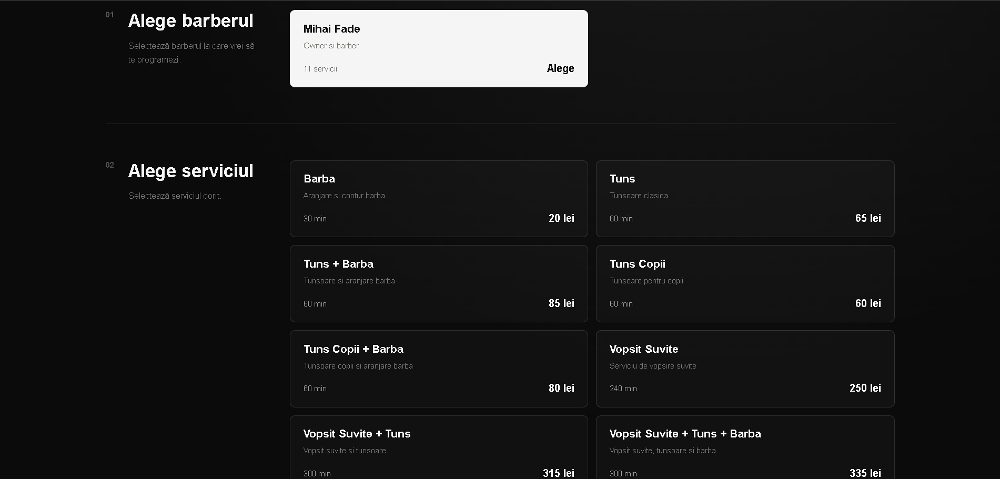
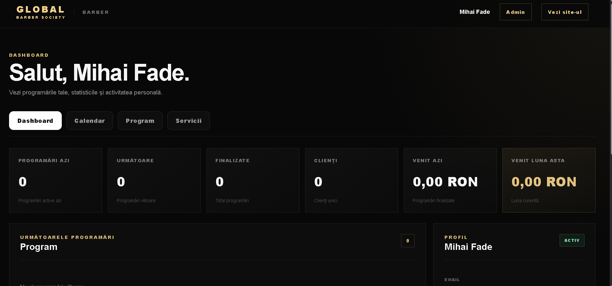
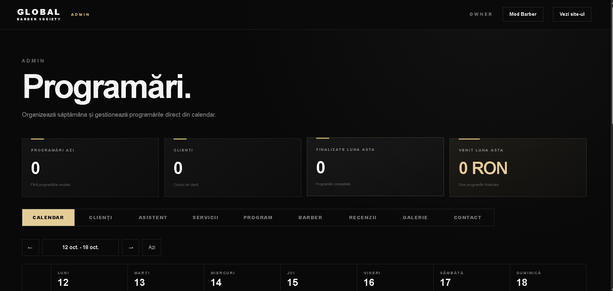

# 💈 Global Barber Society

A full-stack barbershop management and booking platform built with **React, TypeScript, Java, Spring Boot and PostgreSQL**.

## 👨‍💻 About

Global Barber Society is a full-stack application developed to support the operations and digital presence of a modern barbershop, based on real business requirements and day-to-day workflows.

The platform provides a digital solution for appointment booking, client and barber management, rewards, promotional campaigns and business administration.

## 🌐 Live Website

**[https://globalbarber.ro/](https://globalbarber.ro/)**

## 📸 Screenshots

### 🏠 Homepage


### 📅 Appointment Booking



### ✂️ Barber Dashboard



### 👑 Admin Dashboard



## ✨ Features

### 👤 Client

- Account registration and authentication
- Google Sign-In
- Online appointment booking
- Barber and service selection
- Appointment management
- Welcome reward wheel
- Discounts and rewards
- Push notifications and appointment reminders
- Dynamic gallery and barber profiles

### ✂️ Barber

- Dedicated barber dashboard
- Appointment management
- Client reward validation
- Discount validation
- Profile and image management

### 👑 Owner

- Administration dashboard
- Barber and service management
- Schedule and time-off management
- Client management
- Gallery management with cloud uploads
- Client activity and visit filtering
- Promotional push notifications
- Dynamic discount campaigns
- Campaign history

## 🛠️ Tech Stack

**Frontend:** React · TypeScript · Vite · CSS

**Backend:** Java 21 · Spring Boot · Spring Security · Spring Data JPA · JWT

**Database:** PostgreSQL

**Cloud Integrations:** Firebase Cloud Messaging · Cloudinary

**Authentication:** JWT · Google Sign-In

**Tools:** Git · GitHub · Postman · Maven

## 🔐 Authentication & Security

The application uses JWT-based authentication and role-based authorization with three roles:

`CLIENT` · `BARBER` · `OWNER`

Spring Security protects backend endpoints and enforces authorization rules. Google Sign-In provides an additional authentication option for clients.

Sensitive credentials and production configuration are handled through environment variables and excluded from version control.

## ☁️ Cloud Integrations

**Firebase Cloud Messaging (FCM)**  
Supports push notification functionality for appointment-related updates and promotional campaigns.

**Cloudinary**  
Provides cloud storage and delivery for gallery and barber images.

**Google Sign-In**  
Provides an additional authentication method for clients.

## 🏗️ Architecture

The React and TypeScript frontend communicates with a Java Spring Boot REST API responsible for business logic, authentication, authorization and database operations.

PostgreSQL provides persistent data storage, while Firebase Cloud Messaging and Cloudinary support notifications and media management.

```text
global-barber-society-site/
├── frontend/
│   ├── public/
│   │   └── screenshots/
│   │       ├── homepage.png
│   │       ├── admin-dashboard.png
│   │       ├── booking.png
│   │       └── barber-dashboard.png
│   └── src/
├── backend/
└── README.md
```

## 🚀 Getting Started

### Prerequisites

- Node.js and npm
- Java 21
- Maven
- PostgreSQL
- Required Firebase and Cloudinary configuration

### Frontend

```bash
cd frontend
npm install
```

Create a local `.env` file based on `.env.example`, configure the required environment variables, and start the development server:

```bash
npm run dev
```

To create a production build:

```bash
npm run build
```

### Backend

```bash
cd backend
mvn spring-boot:run
```

Configure the required database connection and other environment variables before starting the backend.

For additional setup details, see the README files inside the `frontend/` and `backend/` directories, if available.

## 🔒 Security Notes

- Never commit `.env` files containing real credentials.
- Never upload Firebase service-account private keys.
- Keep database passwords, JWT secrets and private API credentials out of source control.
- Use `.env.example` to document required frontend environment variable names without exposing their values.

## 📌 Project Status

**Live Website · Ongoing Improvements**

The application is available at [globalbarber.ro](https://globalbarber.ro/). Further improvements and maintenance may continue as the platform evolves.

## 📄 License

Proprietary project developed for **Global Barber Society**.

All rights reserved. Unauthorized copying, distribution or commercial use is prohibited without permission from the copyright holder.
